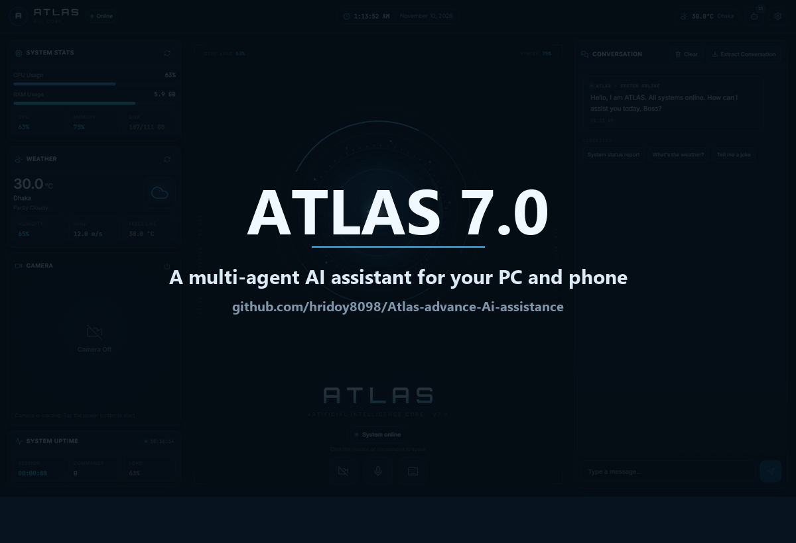

# Atlas 7.0

**A personal AI assistant that runs on your own computer and is controlled from your phone.**

Atlas is not a chatbot in a browser tab. It is a small operating layer for your digital life:

- It **does things** on your PC — opens apps, finds files, runs terminal commands, takes screenshots, reads documents, builds slide decks.
- It has a **web dashboard** (React) that looks like a control room and lets you chat, watch system stats, and switch individual agents on or off.
- It has a **phone shell** (Android + iOS) that talks to your laptop, reads your contacts, starts **WhatsApp calls**, sends SMS, and can act as an **AI call receptionist** when you are busy.
- It can run **on your laptop only**, or on a **cloud server** (e.g. a Hugging Face Space) with your laptop connected to it for PC work.

This README is written to be followed from top to bottom. If you have never seen this project before, start at [Quick start](#quick-start-15-minutes) and work your way down. Every command is shown exactly as you should type it.

---

## Table of contents

1. [What Atlas can do](#what-atlas-can-do)
2. [Screenshots and demo](#screenshots-and-demo)
3. [The honest version: what is real and what is not](#the-honest-version-what-is-real-and-what-is-not)
4. [The 22 agents](#the-22-agents)
5. [How Atlas is put together](#how-atlas-is-put-together)
6. [Tech stack](#tech-stack)
7. [Folder structure](#folder-structure)
8. [What you need before starting](#what-you-need-before-starting)
9. [Quick start (15 minutes)](#quick-start-15-minutes)
10. [Configuration: every environment variable](#configuration-every-environment-variable)
11. [Using the dashboard](#using-the-dashboard)
12. [The Agent Control Panel](#the-agent-control-panel)
13. [Example commands](#example-commands)
14. [Agent-by-agent guide](#agent-by-agent-guide)
15. [The phone app (Android and iOS)](#the-phone-app-android-and-ios)
16. [Laptop connector and cloud relay](#laptop-connector-and-cloud-relay)
17. [Deploy free: GitHub Pages + Render](#deploy-free-github-pages--render)
18. [Deploy to Hugging Face Spaces](#deploy-to-hugging-face-spaces)
19. [Deploy to your own server](#deploy-to-your-own-server)
20. [API reference](#api-reference)
21. [Where your data lives](#where-your-data-lives)
22. [Security notes](#security-notes)
23. [Troubleshooting](#troubleshooting)
24. [Adding your own agent](#adding-your-own-agent)
25. [Roadmap](#roadmap)
26. [Contributing](#contributing)
27. [License](#license)

---

## What Atlas can do

Here is the short version, grouped the way a normal person would think about it.

### Talk to your computer

- “Open Chrome”, “close Spotify”, “lock my PC”, “how much battery is left?”
- “Find the file named budget 2026”, “move all PDFs from Downloads to Documents”
- “Run the tests in this repo”, “what is using my network?”, “clean temporary files”
- “Take a screenshot and tell me what is on the screen”

### Think and write with AI

- Chat in English or Bangla; Atlas detects the language and answers in the same one.
- Deep research with sources, document Q&A with page citations, long YouTube video summaries.
- Turn an idea into a Markdown report, an HTML page, and a real `.pptx` presentation.
- Build a study plan, flashcards, and mock quizzes for an exam.

### Run your day

- Tasks, reminders, notes, pomodoro timer, alarms.
- Meeting scheduling with conflict detection and a downloadable `.ics` calendar file.
- Expense tracking in BDT, budgets, and simple anomaly detection.
- Email inbox triage with urgency ranking and draft replies (IMAP).

### Use your phone as the remote

- Agent Control Panel on the phone, with on/off toggles that actually gate execution.
- Resolve a contact by name from the phone address book.
- Start a WhatsApp call to that contact (with an Android automation option).
- Make a normal phone call from a callback button.
- AI receptionist: when you are busy, take the caller’s name, reason, and message; store it; notify you; call back later.

### Watch your back

- Password strength checks, breach checks (Have I Been Pwned), malware scans (VirusTotal).
- Network scan, risky process ranking, quarantine list.
- Sensitive-data screen and clipboard detection, blur and audit log.
- Privacy mode, watermark, and self-destruct helpers.

---

## Screenshots and demo

Everything below is a real screenshot from the running app — no mockups, no edited UI. The animation walks through the five screens described in this README.



### The screens, one by one

| # | Screen | What you are looking at |
|---|---|---|
| 1 | [Dashboard](docs/demo/01-dashboard.png) | Live CPU, RAM and disk stats, weather, camera card, the Arc Reactor, and the conversation panel. |
| 2 | [Agent Control Panel](docs/demo/02-agent-panel.png) | All 22 agents with their on/off switches, permissions, health badges and step-by-step pipelines. |
| 3 | [Call agents](docs/demo/03-call-agents.png) | The two phone-first agents: **WhatsApp Call Agent** and **AI Call Receptionist**. |
| 4 | [Agent detail](docs/demo/04-agent-detail.png) | Expanded agent card: permissions, health, actions and the saved contact list used for WhatsApp calls. |
| 5 | [Chat command](docs/demo/05-chat-command.png) | Typing “system status” and getting a real PC report from the PC Control Agent — CPU, RAM, disk, uptime and battery. |

The screenshots were taken from the production build (`npm run build`, then `python server.py`) on a Windows laptop. Your own numbers, weather and machine name will be different.

### Regenerate the demo

The capture pipeline is included, so you can refresh the images after changing the UI:

```bash
python tools/capture_demo.py     # writes the five PNGs to docs/demo/
python tools/build_demo_gif.py   # builds docs/demo/atlas-demo.gif
```

`capture_demo.py` uses headless Chrome through the DevTools protocol, so it does not need Playwright or Selenium. Set `ATLAS_DEMO_URL=http://localhost:5173/` to capture from the Vite dev server instead of the production server.

---

## The honest version: what is real and what is not

A lot of AI assistant projects look impressive in a video and fall apart when you run them. This section exists so you know exactly what you are getting.

| Area | Status | Details |
|---|---|---|
| Chat, routing, agent panel | **Real** | Needs at least one AI key for reasoning; toggles and health work without keys. |
| PC control, files, terminal, screen | **Real** | Runs on the machine that runs `server.py`. |
| Document Q&A, PPTX export, research | **Real** | Real file parsing, real `.pptx` generation, real web fetches. |
| WhatsApp call to a saved contact | **Real** | Opens the contact’s WhatsApp chat and hands off to the call UI. |
| Fully automatic WhatsApp voice call | **Android only, best effort** | Uses an AccessibilityService for a 20-second window. Not an official WhatsApp API. iOS cannot do this. |
| AI receptionist, simulated call | **Real** | Full pipeline: transcript → name/reason/message → saved call record → notification → callback. |
| AI receptionist on a real phone number | **Not included** | Requires a cloud telephony provider (Twilio or SIP) and a virtual number. The adapter is marked for the next phase. |
| Email triage | **Real, needs IMAP** | Gmail App Password or any IMAP account. Nothing is sent without your approval. |
| iOS app | **Code included, not buildable here** | Needs macOS + Xcode + Apple signing. |
| Voice wake word | **Real on Windows** | Continuous listening; can be disabled with `ATLAS_VOICE_AUTOSTART=0`. |

If a feature needs an external account or hardware you do not have, the rest of Atlas still runs. That is by design: every agent fails gracefully and tells you what is missing instead of crashing the server.

---

## The 22 agents

Atlas ships with 22 agents. **15 are ON by default.** You can change any of them from the Agent Control Panel.

### Core agents (8, all ON by default)

| # | Agent | ID | What it does |
|---|---|---|---|
| 1 | PC Control Agent | `pc` | System status, shutdown, restart, lock, battery, WiFi, safe cleanup. |
| 2 | File Agent | `file` | Search, create, copy, move, rename, organize files. |
| 3 | Web Research Agent | `web` | Search, read pages, summarize, translate, bookmarks. |
| 4 | Media Agent | `media` | YouTube, music, video, images, memes, downloads. |
| 5 | Productivity Agent | `productivity` | Tasks, reminders, notes, calendar, pomodoro, alarms. |
| 6 | Security Agent | `security` | Privacy mode, password checks, breach checks, malware scan. |
| 7 | App Agent | `app` | Open and control desktop and phone applications. |
| 8 | Terminal Agent | `terminal` | Safe shell commands, git and package operations. |

### Call agents (2, both OFF by default)

| # | Agent | ID | What it does |
|---|---|---|---|
| 9 | WhatsApp Call Agent | `whatsapp_call` | Resolve a saved contact by name and start a WhatsApp voice call. |
| 10 | AI Call Receptionist | `call_receptionist` | Answer while busy, take a message, notify you, optionally call back. |

### Advanced agents (12)

| # | Agent | ID | Default | What it does |
|---|---|---|---|---|
| 11 | Coding Copilot Agent | `coding` | OFF | Scan a repo, plan a fix, edit files, run tests, summarize the diff. |
| 12 | Screen Vision RPA Agent | `screen_rpa` | OFF | Read the screen, detect fields, perform repetitive click/type workflows. |
| 13 | Deep Research Agent | `research_pro` | ON | Multi-source research with cross-checking and cited reports. |
| 14 | Document Intelligence Agent | `doc_intel` | ON | Read PDFs/DOCX, index chunks, answer with page citations. |
| 15 | Exam Prep Coach Agent | `exam_coach` | ON | Study plan, weak topics, flashcards, mock tests. |
| 16 | YouTube Learning Agent | `yt_learn` | ON | Find a video, play it, fetch transcript, summarize, quiz. |
| 17 | Presentation Builder Agent | `report_builder` | ON | Outlines, charts, slide content, PPTX/HTML/Markdown export. |
| 18 | Email Triage Agent | `email_triage` | OFF | Fetch inbox, classify urgency, summarize, draft replies. |
| 19 | Meeting Autopilot Agent | `meeting_autopilot` | OFF | Find a free slot, create the event, invite people, prepare an agenda. |
| 20 | Personal Finance Agent | `finance` | ON | Categorize expenses, check budgets, detect anomalies, build reports. |
| 21 | Security Sentinel Agent | `security_sentinel` | OFF | Malware, network and breach checks with risk ranking and quarantine. |
| 22 | Privacy Guardian Agent | `privacy_guardian` | ON | Detect sensitive screen/clipboard data, blur it, audit privacy events. |

**Why are some agents OFF by default?** Because they either touch people outside your machine (WhatsApp, email, meetings), can change your system in destructive ways (coding edits, screen automation), or produce scary-looking results until you configure them (security scans). Everything is one toggle away.

---

## How Atlas is put together

Atlas has three pieces that can run on one machine or be split across machines.

```
 ┌──────────────────────────────┐        ┌─────────────────────────────────┐
 │  Phone (Android / iOS)       │        │  Laptop (Windows / macOS / Linux)│
 │  Capacitor shell + React UI  │        │                                  │
 │                              │  HTTP  │  FastAPI  ──►  Agent Orchestrator│
 │  • Agent Control Panel       │ ─────► │      │             │           │
 │  • Contacts / WhatsApp       │        │      │             ├─ PC, File  │
 │  • Phone calls, SMS          │        │      ▼             ├─ Terminal  │
 │  • Receptionist inbox        │        │  AI engine         ├─ Screen    │
 └──────────────────────────────┘        │  (Gemini/Groq)     └─ ...       │
              │                          └─────────────────────────────────┘
              │  optional cloud relay                  ▲
              ▼                                        │ one outbound WebSocket
 ┌──────────────────────────────┐                       │ (no port forwarding)
 │  Cloud server (HF Space)     │───────────────────────┘
 │  • public URL for the phone  │        laptop connector
 │  • pair-token authentication │
 │  • call agents stay here     │
 └──────────────────────────────┘
```

### The request path

1. The phone or dashboard sends `POST /api/command` with a command and a `platform`.
2. `command_handler.py` checks whether the text is an agent command (`is_agent_command`).
3. If yes, the **Agent Orchestrator** picks the right agent by intent, checks whether that agent is **enabled**, and runs it.
4. If no agent matches, the text goes to the normal AI chat pipeline.
5. In cloud mode (`ATLAS_CLOUD=1`), PC/desktop commands are relayed to the paired laptop connector instead of running on the Space. Phone-only agents (WhatsApp call, receptionist) always run locally.

### Two things worth knowing

- **Disabled means disabled.** A disabled agent is not just hidden in the UI. The orchestrator refuses to execute it and returns a clear “agent is disabled” message.
- **Every agent returns the same shape.** `{ success, agent, message, ...extra }`. That is why the dashboard, the phone, and the API can all render any agent without special cases.

---

## Tech stack

| Layer | Technology |
|---|---|
| Backend | Python 3.11+, FastAPI, Uvicorn |
| AI | Google Gemini (primary), Groq (fallback), automatic key rotation |
| Memory | SQLite + ChromaDB vector store |
| Voice | SpeechRecognition, edge-tts, pygame |
| Automation | pyautogui, psutil, Pillow, OpenCV |
| Documents | python-docx, pypdf, python-pptx, openpyxl |
| Frontend | React 18, Vite, Zustand, Tailwind, Framer Motion, Recharts |
| Phone | Capacitor 6, native Android Java plugins, Swift plugin for iOS |
| Transport | REST + WebSocket, outbound connector WebSocket |
| Packaging | Docker multi-stage (Node build → Python runtime) |

---

## Folder structure

```
Atlas react main/
├── server.py                     # FastAPI app, routes, static frontend mount
├── config.py                     # Paths, keys, model names, runtime dirs
├── command_handler.py            # Command gate + AI chat fallback
├── run.py                        # One-command launcher (backend + frontend)
├── requirements.txt              # Full desktop dependencies
├── requirements-hf.txt           # Slim dependencies for the cloud image
├── Dockerfile                    # HF Space / server image (port 7860)
├── .env.example                  # Every supported variable, no secrets
│
├── backend/
│   ├── agent/                    # 22 agents + registry + orchestrator
│   ├── communication/            # Contacts, WhatsApp call, receptionist
│   ├── connector/                # Cloud relay manager
│   ├── routers/                  # /api/agents, /api/communication, ...
│   ├── core/                     # AI engine, memory, parser, voice
│   ├── auth/                     # PIN, face, voice, sessions
│   ├── security/                 # Privacy, malware, breach helpers
│   ├── study/  media/  life/     # Domain services
│   └── analytics/  system/       # Stats and system helpers
│
├── frontend/                     # React dashboard
│   ├── src/components/jarvis/    # HUD, chat, AgentPanel, settings
│   ├── src/components/panels/    # Analytics, security, study, media
│   └── src/services/             # Axios API clients
│
├── mobile/                       # Capacitor phone shell
│   ├── android/                  # Native Android project + plugins
│   ├── native/ios/               # Swift plugin for iOS
│   └── README.md                 # Mobile-specific notes
│
├── connector/atlas_laptop.py     # Outbound WebSocket connector
├── deploy/hf/README.md           # Hugging Face deployment guide
├── docs/demo/                    # README screenshots + demo GIF
├── tools/                        # capture_demo.py + build_demo_gif.py
├── data/                         # Runtime data (git-ignored)
└── logs/                         # Runtime logs (git-ignored)
```

---

## What you need before starting

| Requirement | Why | Check |
|---|---|---|
| **Python 3.11 or newer** | Backend | `python --version` |
| **Node.js 20 or newer** | Frontend build | `node --version` |
| **npm** | Comes with Node | `npm --version` |
| **Git** | Clone and update | `git --version` |
| **Windows 10/11, macOS 12+, or Linux** | Desktop agents | — |
| **At least one AI key** | Chat and reasoning | Gemini or Groq |
| **Android Studio or Android SDK** | Only for the Android app | `adb version` |
| **macOS + Xcode** | Only for the iOS app | `xcodebuild -version` |

Optional but useful:

- A free [Google AI Studio](https://aistudio.google.com/) key (Gemini).
- A free [Groq](https://console.groq.com/) key (fast fallback).
- A [WeatherAPI](https://www.weatherapi.com/) key for weather.
- A [VirusTotal](https://www.virustotal.com/) key for malware checks.
- A [Have I Been Pwned](https://haveibeenpwned.com/API/Key) key for breach checks.
- A [NewsAPI](https://newsapi.org/) key for news.

You do **not** need all of them. Atlas starts with zero keys and tells you what is missing.

---

## Quick start (15 minutes)

### Step 1 — Get the code

```bash
git clone https://github.com/hridoy8098/Atlas-advance-Ai-assistance.git
cd Atlas-advance-Ai-assistance
```

If you downloaded a ZIP instead, extract it and open a terminal in that folder.

> All commands below are shown for **PowerShell on Windows** first, then macOS/Linux where they differ.

### Step 2 — Create a virtual environment

Windows (PowerShell):

```powershell
python -m venv .venv
.\.venv\Scripts\Activate.ps1
```

macOS / Linux:

```bash
python3 -m venv .venv
source .venv/bin/activate
```

If PowerShell blocks the activation script, run this once in the same window:

```powershell
Set-ExecutionPolicy -Scope Process -ExecutionPolicy Bypass
```

You should see `(.venv)` at the start of your prompt. That means the environment is active.

### Step 3 — Install Python packages

```bash
python -m pip install --upgrade pip
pip install -r requirements.txt
```

**Microphone note (optional).** `pyaudio` is intentionally not in `requirements.txt` because it needs native audio libraries. Everything works without it except microphone input. If you want voice commands:

```powershell
pip install pipwin
pipwin install pyaudio
```

On macOS: `brew install portaudio && pip install pyaudio`. On Linux: `sudo apt install portaudio19-dev && pip install pyaudio`.

**ChromaDB note.** The first run downloads a small embedding model. That is normal and only happens once.

### Step 4 — Create your `.env`

Windows:

```powershell
Copy-Item .env.example .env
```

macOS / Linux:

```bash
cp .env.example .env
```

Open `.env` in any text editor and fill in **at least** these three lines:

```env
GEMINI_API_KEY=your_key_here
AUTH_PIN=123456
USER_NAME=Boss
```

If you only have Groq, use:

```env
GROQ_KEY_1=your_key_here
AI_PRIMARY=groq
```

Save the file. Never commit `.env` — it is already in `.gitignore`.

### Step 5 — Install frontend packages

```bash
cd frontend
npm install
cd ..
```

This takes a minute or two the first time.

### Step 6 — Start the backend

```bash
python server.py
```

You should see:

```
Uvicorn running on http://0.0.0.0:8000
```

Leave this terminal open. Useful URLs:

- API root: <http://localhost:8000>
- Interactive API docs: <http://localhost:8000/docs>
- Health check: <http://localhost:8000/api/health>

### Step 7 — Start the frontend (development)

Open a **second** terminal, activate the virtual environment if needed, then:

```bash
cd frontend
npm run dev
```

Open <http://localhost:5173>. The Vite dev server proxies `/api` and `/ws` to `http://localhost:8000`, so the two ports work together automatically.

### Step 8 — Log in

Atlas asks for a PIN.

- If you set `AUTH_PIN` in `.env`, that is your PIN.
- If you left it empty, the fallback PIN is `123456`.

Change the PIN before exposing Atlas to any network you do not control.

### Step 9 — Turn on the agents you want

Look at the top bar. Next to the settings gear there is a **robot icon with a number badge**. That number is how many agents are currently enabled.

1. Click the robot icon.
2. Browse by category (Core, Call, Study, Productivity, Security, Advanced).
3. Toggle any agent on or off.
4. Expand an agent to read its description and press **Test** to run its self-check.

Only enabled agents can run. If you ask for something that belongs to a disabled agent, Atlas tells you which agent to enable.

### Step 10 — Use it

Type in the chat box, for example:

```
what is my battery level
find files named invoice
explain this error: ModuleNotFoundError no module named fastapi
```

Or say the wake word if voice is enabled.

### Step 11 — Next time, one command

```bash
python run.py
```

This starts the backend, starts the Vite dev server, and opens `http://localhost:5173` in your browser.

### Step 12 — Production mode (single port)

When you are done developing, build the frontend once:

```bash
cd frontend
npm run build
cd ..
python server.py
```

Now FastAPI serves the built files itself at <http://localhost:8000>. No second terminal, no Vite. This is also exactly what the Docker image does.

---

## Configuration: every environment variable

All variables are optional unless marked required. Blank values are treated as “not configured”.

### AI

| Variable | Default | Purpose |
|---|---|---|
| `GEMINI_API_KEY` | empty | Primary AI key. Get one at aistudio.google.com. |
| `GEMINI_API_KEY_2`, `_3`, ... | empty | Extra Gemini keys. Atlas rotates through them when one hits a quota limit. |
| `GROQ_KEY_1` ... `GROQ_KEY_10` | empty | Groq fallback keys, also rotated. |
| `AI_PRIMARY` | `gemini` | `gemini` or `groq`. Use `groq` if you have no Gemini key. |
| `USER_NAME` | `Boss` | How Atlas addresses you. |
| `AUTH_PIN` | `123456` (fallback) | Dashboard PIN. Change this. |
| `DEBUG` | `False` | Verbose logging. |
| `LOG_LEVEL` | `INFO` | Python log level. |

### Optional data providers

| Variable | Used by | Purpose |
|---|---|---|
| `WEATHER_API_KEY` | Weather card, PC agent | Current weather and forecast. |
| `VIRUSTOTAL_API_KEY` | Security Agent, Security Sentinel | File hash malware lookups. |
| `HIBP_API_KEY` | Security Agent, Security Sentinel | Breach checks. |
| `NEWS_API_KEY` | Bangladesh panel, news commands | Headlines. |

### Email (Email Triage Agent)

| Variable | Default | Purpose |
|---|---|---|
| `ATLAS_IMAP_HOST` | empty | e.g. `imap.gmail.com` |
| `ATLAS_IMAP_USER` | empty | Your full email address |
| `ATLAS_IMAP_PASS` | empty | App password (not your normal password) |
| `ATLAS_IMAP_PORT` | `993` | Usually 993 for SSL |
| `ATLAS_IMAP_FOLDER` | `INBOX` | Folder to read |
| `ATLAS_IMAP_SSL` | `1` | Set `0` for plain IMAP |

`EMAIL_HOST`, `EMAIL_USER`, `EMAIL_PASS`, `IMAP_HOST`, `IMAP_USER`, `IMAP_PASS`, `GMAIL_USER`, and `GMAIL_APP_PASSWORD` are also accepted as aliases.

**Gmail setup:** enable 2-Step Verification → Google Account → Security → App passwords → create one for “Mail” → paste it into `ATLAS_IMAP_PASS`.

### Voice

| Variable | Default | Purpose |
|---|---|---|
| `ATLAS_VOICE_AUTOSTART` | `1` | Set `0` to disable continuous wake-word listening on the laptop. |
| `AI_PRIMARY` | `groq` | `groq` keeps short voice replies sub-second; Gemini stays as the fallback. |
| `GROQ_WHISPER_MODEL` | `whisper-large-v3` | Speech-to-text model used by `/api/voice/transcribe`. |
| `EDGE_VOICE_BN` | `bn-BD-NabanitaNeural` | Edge TTS voice for Bengali replies. |
| `EDGE_VOICE_EN` | `en-US-JennyNeural` | Edge TTS voice for English replies. |
| `TTS_SPEED` | `+0%` | Edge TTS speaking rate (for example `+10%` for a faster reply). |

Set `ATLAS_VOICE_AUTOSTART=0` on servers, in Docker, and whenever you do not want the laptop microphone open. The phone app does not use this setting: it records only when you tap the microphone.

**How web and phone voice works.** The browser or phone records with `MediaRecorder`, stops after about 1.4 seconds of silence, and uploads the clip to `/api/voice/transcribe`. The server runs Groq Whisper `large-v3` twice in parallel (forced Bengali and forced English) and keeps the result with the higher average log-probability. This is deliberate: forcing English on Bengali audio can return a fluent English *translation*, so script detection alone is not reliable. The reply is generated by Groq, rendered to an MP3 by Edge TTS, and played by the client. Web and phone send `client_tts: true` so a locally running server does not also speak through the laptop speakers; if a desktop browser blocks autoplay, the frontend falls back to the built-in `speechSynthesis` voice.

In **Settings → Voice language**, `Auto` uses the dual-pass detector. Choosing **বাংলা** or **English** explicitly sends one language hint and is slightly faster; use it if Auto ever guesses wrong on a noisy clip.

### Cloud relay and pairing

| Variable | Default | Purpose |
|---|---|---|
| `ATLAS_CLOUD` | `0` | Set `1` on a cloud server so PC commands are relayed to the paired laptop. |
| `ATLAS_PAIR_TOKEN` | empty | Shared secret between server and laptop connector. Use a long random string. |

### Telephony (future real receptionist)

| Variable | Purpose |
|---|---|
| `TWILIO_ACCOUNT_SID` | Twilio account SID |
| `TWILIO_AUTH_TOKEN` | Twilio auth token |
| `TWILIO_PHONE_NUMBER` | Your virtual number |
| `ATLAS_VIRTUAL_NUMBER` | Alternative SIP/virtual number label |

Without these, the receptionist runs in **simulator mode**: every call and callback is real inside Atlas, but no external phone line is involved.

---

## Using the dashboard

The interface is a single “JARVIS-style” HUD with a few areas:

| Area | What you can do |
|---|---|
| **Top bar** | Agent panel (robot icon), settings, connection status, quick actions. |
| **Core display** | Animated status ring; shows listening, thinking, and speaking states. |
| **Chat / conversation** | Type commands, read agent replies, see which agent handled the request. |
| **System cards** | CPU, RAM, battery, uptime, weather. |
| **Side panels** | Analytics, security, study, media, Bangladesh info. |
| **Settings menu** | Interface options, server setup, pairing code, connector status. |

### Keyboard and voice

- Type in the chat box and press Enter.
- If voice is enabled, say the wake word, then speak. Atlas transcribes, routes, and replies.
- Stop speaking at any time from the voice control.

### Server setup / pairing

Open Settings → Server Setup to see:

- The current server URL.
- The pairing code (when `ATLAS_PAIR_TOKEN` is set).
- Whether the laptop connector is online.

---

## The Agent Control Panel

This is the most important screen in the project, because it is how you stay in control.

### Opening it

Click the **robot icon** in the top bar, right next to settings. The badge shows the enabled count.

### What you see

- **Header:** total agents, enabled count, health summary.
- **Search:** filter by name or description.
- **Category tabs:** all / core / call / study / productivity / security / advanced.
- **Agent card:** name, description, ON/OFF switch, health badge.
- **Expand:** example commands, requirements, and a **Test** button.

### Health badges explained

| Badge | Meaning |
|---|---|
| `ready` | The agent is enabled and its dependencies are available. |
| `setup` | The agent needs a key or account (for example IMAP or VirusTotal). |
| `missing` | A required package or service is not installed. |
| `disabled` | You turned it off. This is expected, not an error. |

### The API behind it

| Method | Endpoint | Purpose |
|---|---|---|
| GET | `/api/agents` | List all agents, their state, description, and category. |
| GET | `/api/agents/health` | Run dependency checks and return counts. |
| GET | `/api/agents/{id}` | One agent’s details. |
| POST | `/api/agents/{id}/toggle` | Body: `{"enabled": true}` |
| POST | `/api/agents/bulk-toggle` | Body: `{"ids": ["coding"], "enabled": false}` or `{"category": "study", "enabled": true}` |
| POST | `/api/agents/{id}/test` | Run the agent’s built-in self-test. |

Settings are persisted in `data/agent_settings.json`, so they survive restarts.

### Good default policy

- Keep core agents ON.
- Keep call agents OFF until you have contacts and understand the WhatsApp flow.
- Turn on `coding` only when you are actively working on a repo.
- Turn on `screen_rpa` only when you are watching the screen.
- Turn on `email_triage` after IMAP is configured.
- Turn on `security_sentinel` when you want a scan, then turn it off.

---

## Example commands

Atlas understands English and Bangla. These are real routing examples.

### PC and files

| Command | Agent |
|---|---|
| `system status` | `pc` |
| `lock my pc` | `pc` |
| `battery level` | `pc` |
| `find file budget 2026` | `file` |
| `move all pdfs from downloads to documents` | `file` |
| `clean temporary files` | `pc` |
| `run git status` | `terminal` |
| `open chrome` | `app` |
| `take a screenshot` | `screen_rpa` (must be enabled) |
| `screen size` | `screen_rpa` |

### Research and learning

| Command | Agent |
|---|---|
| `deep research on climate adaptation in Bangladesh` | `research_pro` |
| `summarize this pdf C:\docs\report.pdf` | `doc_intel` |
| `ask this docx what is the launch date` | `doc_intel` |
| `make a 14 day study plan for physics` | `exam_coach` |
| `quiz me on chapter 3` | `exam_coach` |
| `youtube transformer explained summary` | `yt_learn` |
| `presentation on AI in education 4 slides` | `report_builder` |
| `build a report on monthly sales` | `report_builder` |

### Work and money

| Command | Agent |
|---|---|
| `inbox summary` | `email_triage` |
| `any urgent email` | `email_triage` |
| `meeting schedule tomorrow 3pm with Rahim` | `meeting_autopilot` |
| `expense 250 lunch` | `finance` |
| `expense report` | `finance` |
| `budget report` | `finance` |
| `network scan` | `security_sentinel` |
| `privacy audit` | `privacy_guardian` |

### Calls (phone platform)

| Command | Agent |
|---|---|
| `WhatsApp e Ammu ke call koro` | `whatsapp_call` |
| `call Ammu on WhatsApp` | `whatsapp_call` |
| `call Rahim` | `whatsapp_call` or phone dial, depending on platform |
| `receptionist on` / `I am busy` | `call_receptionist` |

---

## Agent-by-agent guide

Each entry tells you what the agent does, how to trigger it, and what it needs.

### 1. PC Control Agent (`pc`)

- **Triggers:** “system status”, “cpu”, “ram”, “battery”, “wifi”, “lock”, “shutdown”, “restart”, “clean temp”.
- **Needs:** `psutil`. Shutdown/restart are guarded and ask for confirmation in the UI.
- **Notes:** This agent runs on whatever machine runs the backend. In cloud mode it runs on the paired laptop.

### 2. File Agent (`file`)

- **Triggers:** “find file …”, “search files …”, “create folder …”, “move …”, “copy …”, “rename …”, “organize downloads”.
- **Needs:** nothing extra.
- **Notes:** Paths are resolved against the project root and your home directory. Destructive moves are logged.

### 3. Web Research Agent (`web`)

- **Triggers:** “search …”, “what is …”, “read this page …”, “translate …”, “bookmark …”.
- **Needs:** internet, AI key.
- **Notes:** Returns sources when the page can be fetched.

### 4. Media Agent (`media`)

- **Triggers:** “play …”, “pause”, “youtube …”, “download video …”, “meme …”, “remove background …”.
- **Needs:** `yt-dlp`/`ffmpeg` for downloads (optional), pygame for local playback.
- **Notes:** Some actions are desktop-only.

### 5. Productivity Agent (`productivity`)

- **Triggers:** “task …”, “remind me …”, “note …”, “pomodoro …”, “alarm …”, “calendar …”.
- **Needs:** nothing.
- **Notes:** Stored in SQLite under `data/`.

### 6. Security Agent (`security`)

- **Triggers:** “password strength …”, “breach check …”, “malware scan …”, “privacy mode”.
- **Needs:** `HIBP_API_KEY` and `VIRUSTOTAL_API_KEY` for the online parts.
- **Notes:** Works offline for local checks.

### 7. App Agent (`app`)

- **Triggers:** “open chrome”, “close spotify”, “open notepad”.
- **Needs:** the app installed on the backend machine.
- **Notes:** A small allow-list keeps typos from launching random things.

### 8. Terminal Agent (`terminal`)

- **Triggers:** “run …”, “git status”, “pip install …”.
- **Needs:** nothing.
- **Notes:** This is powerful. Treat dashboard access as shell access to your machine. A confirmation step and a command blocklist are in place, but do not expose Atlas publicly without HTTPS and a strong PIN.

### 9. WhatsApp Call Agent (`whatsapp_call`)

- **Triggers:** “WhatsApp e Ammu ke call koro”, “call Ammu on WhatsApp”.
- **Needs:** the phone app, a saved contact, WhatsApp installed.
- **Flow:** command → contact resolver → phone contact lookup → open WhatsApp chat → start call.
- **Android:** if the Atlas accessibility service is enabled, Atlas taps the call button automatically inside a 20-second window.
- **iOS:** Atlas opens the chat; you tap the call button once. This is an iOS restriction.
- **Risk:** personal WhatsApp automation is not an official API. Read the warning in `mobile/README.md` before enabling it.

### 10. AI Call Receptionist (`call_receptionist`)

- **Triggers:** “I am busy”, “receptionist on”, or the phone panel button.
- **What it does:** takes a call record, extracts name/reason/message with AI, stores it, notifies you, and lets you call back with one tap.
- **Simulator:** `POST /api/communication/receptionist/simulate` creates a realistic test call.
- **Real phone line:** needs Twilio/SIP plus a virtual number. Without it, no external call reaches Atlas.
- **Inbox:** last 50 calls in the panel, with a **Call back** button that uses the native dialer on a phone.

### 11. Coding Copilot Agent (`coding`)

- **Triggers:** “code review <path>”, “fix the bug in <file>”, “run tests”, “summarize this diff”.
- **Needs:** the repo on the backend machine.
- **Notes:** Starts OFF. It scans, plans, edits, and runs tests, but shows a summary before you rely on it.

### 12. Screen Vision RPA Agent (`screen_rpa`)

- **Triggers:** “take a screenshot”, “what is on my screen”, “click …”, “type …”, “press ctrl+s”.
- **Needs:** `pyautogui`, `Pillow`, a real display.
- **Notes:** Starts OFF. Do not use it on a headless server.

### 13. Deep Research Agent (`research_pro`)

- **Triggers:** “deep research on …”, “compare … with sources”.
- **Needs:** internet, AI key.
- **Notes:** Fetches several sources, extracts claims, cross-checks, and writes a cited Markdown report into `data/research/`.

### 14. Document Intelligence Agent (`doc_intel`)

- **Triggers:** “index this pdf …”, “ask this docx …”, “list documents”.
- **Needs:** `pypdf`, `python-docx`.
- **Notes:** Chunks documents, stores them in `data/doc_index.json`, and answers with page numbers.

### 15. Exam Prep Coach Agent (`exam_coach`)

- **Triggers:** “study plan for …”, “quiz me on …”, “flashcards for …”, “weak topics”.
- **Needs:** AI key for generated content.
- **Notes:** Plans, quiz results, and weak topics are stored in `data/exam_coach.json`.

### 16. YouTube Learning Agent (`yt_learn`)

- **Triggers:** “youtube <topic> summary”, “transcript of <url>”, “quiz me on this video”.
- **Needs:** internet; `yt-dlp` helps with transcripts.
- **Notes:** Saves notes in `data/yt_notes/`. Falls back to video metadata when a transcript is unavailable.

### 17. Presentation Builder Agent (`report_builder`)

- **Triggers:** “presentation on …”, “build a report on …”, “make slides …”.
- **Needs:** `python-pptx` for `.pptx`.
- **Notes:** Produces Markdown + HTML + PPTX in `data/reports/`, and an index you can browse.

### 18. Email Triage Agent (`email_triage`)

- **Triggers:** “inbox summary”, “urgent emails”, “draft a reply to …”.
- **Needs:** IMAP variables above.
- **Notes:** Starts OFF. Read-only by default; replies are drafts for your approval.

### 19. Meeting Autopilot Agent (`meeting_autopilot`)

- **Triggers:** “meeting with Rahim tomorrow 3pm”, “find a free slot”, “agenda for …”.
- **Needs:** nothing for local scheduling.
- **Notes:** Starts OFF. Writes `data/meetings.json` and a real `.ics` file per event, with conflict detection and alternate slots.

### 20. Personal Finance Agent (`finance`)

- **Triggers:** “expense 250 lunch”, “expense report”, “budget 5000 food”, “budget report”.
- **Needs:** nothing.
- **Notes:** Uses the analytics SQLite database. Amounts are in BDT by default.

### 21. Security Sentinel Agent (`security_sentinel`)

- **Triggers:** “network scan”, “malware scan <path>”, “breach check <email>”, “risky processes”.
- **Needs:** optional VirusTotal/HIBP keys.
- **Notes:** Starts OFF. Produces risk-ranked findings and a quarantine list; it does not silently delete files.

### 22. Privacy Guardian Agent (`privacy_guardian`)

- **Triggers:** “privacy audit”, “scan sensitive files”, “blur my screen”, “clear clipboard”.
- **Needs:** nothing for local scans.
- **Notes:** Scans file names and clipboard content for sensitive patterns, writes an audit trail, and can blur or watermark the screen.

---

## The phone app (Android and iOS)

The phone app is a **Capacitor** shell around the same React dashboard. It adds native features that a browser cannot provide:

- Read the phone address book and resolve a name to a number.
- Open a WhatsApp chat with a specific contact.
- Start a WhatsApp voice call (Android automation; iOS one tap).
- Make a normal phone call from a number.
- Send an SMS.
- Show the receptionist inbox and call back.

### What works on which platform

| Feature | Android | iOS |
|---|---|---|
| Dashboard + Agent Control Panel | Yes | Yes |
| Read contacts | Yes | Yes |
| Open WhatsApp chat | Yes | Yes |
| Automatic WhatsApp voice call | Yes, AccessibilityService (best effort) | No, one tap required |
| Normal phone call | Yes, direct | Yes, with system confirmation |
| Send SMS | Yes, direct | Composer opens |
| AI receptionist inbox + callback | Yes | Yes |
| Real inbound receptionist calls | Needs cloud number | Needs cloud number |

### Build the Android app

**Requirements:** JDK 17+ (JDK 21 works), Android SDK platform 35, build-tools 35, Node 20+.

1. Build the web assets:

   ```powershell
   cd frontend
   npm run build
   cd ..
   ```

2. Install mobile dependencies and sync:

   ```powershell
   cd mobile
   npm install
   npx cap sync android
   ```

3. One-time SDK setup (if you do not have Android Studio):

   ```powershell
   sdkmanager "platform-tools" "platforms;android-35" "build-tools;35.0.0"
   ```

   Create `mobile/android/local.properties`:

   ```properties
   sdk.dir=C\:\\Users\\<you>\\AppData\\Local\\Android\\Sdk
   ```

4. Build the debug APK:

   ```powershell
   cd mobile\android
   .\gradlew.bat assembleDebug
   ```

5. The APK is here:

   ```
   mobile\android\app\build\outputs\apk\debug\app-debug.apk
   ```

6. Install it on a USB-connected phone with developer mode and USB debugging enabled:

   ```powershell
   adb devices
   adb install -r mobile\android\app\build\outputs\apk\debug\app-debug.apk
   ```

7. Launch the app and continue to the connection step below.

### Build the iOS app

iOS must be built on macOS with Xcode.

```bash
cd mobile
npm install
npx cap add ios
npx cap sync ios
npx cap open ios
```

Then, in Xcode:

1. Add `mobile/native/ios/AtlasNativePlugin.swift` to the App target.
2. Add `NSContactsUsageDescription` to `Info.plist` with a human-readable reason.
3. Select your signing team.
4. Build and run on a device.

### Connect the phone to the laptop

There are three supported ways. Pick the one that matches your situation.

#### Option A — Same WiFi (easiest)

1. Start the backend on the laptop: `python server.py`.
2. Find the laptop’s LAN IP:

   ```powershell
   ipconfig
   ```

   Look for `IPv4 Address`, for example `192.168.0.105`.

3. Allow Python through Windows Firewall on **private networks** when prompted.
4. In the phone app, open the Connect screen and enter:

   ```
   http://192.168.0.105:8000
   ```

5. Tap Connect.

#### Option B — USB cable with `adb reverse` (works across different WiFi networks)

1. Connect the phone by USB and accept the RSA fingerprint prompt.
2. Run:

   ```powershell
   adb reverse tcp:8000 tcp:8000
   ```

3. In the app, connect to:

   ```
   http://localhost:8000
   ```

This tunnels the phone’s `localhost:8000` to the laptop’s `8000` over USB. You must re-run `adb reverse` after unplugging or rebooting.

#### Option C — Cloud URL

Deploy the backend to a Hugging Face Space or your own server (see below), then enter the public URL, for example:

```
https://your-user-atlas-7.hf.space
```

This is the only option that works when the phone is on mobile data and the laptop is behind a router.

### Enable the WhatsApp call flow

1. Make sure **WhatsApp Call Agent** is ON in the Agent Control Panel.
2. Add a contact in the panel, or rely on the phone address book.
3. Say or type: `WhatsApp e Ammu ke call koro`.
4. On Android, to skip the manual tap:
   - Open Android Settings → Accessibility.
   - Find **Atlas WhatsApp call assistant**.
   - Turn it on and accept the warning.

The accessibility service only acts for about 20 seconds after an Atlas request. It does not read messages.

### Enable the AI receptionist

1. Turn on **AI Call Receptionist** in the panel.
2. Set yourself busy:
   - In the panel, press **Busy**, or
   - Send `receptionist on`, or
   - `POST /api/communication/receptionist/busy` with `{"busy": true}`.
3. Simulate a call to test the whole pipeline:

   ```bash
   curl -X POST http://localhost:8000/api/communication/receptionist/simulate ^
     -H "Content-Type: application/json" ^
     -d "{\"from\":\"+8801700000000\",\"name\":\"Rahim\",\"reason\":\"About the project meeting\"}"
   ```

4. Open the receptionist inbox in the panel. You will see the call, the extracted name/reason/message, and a **Call back** button.

For real inbound calls you need a virtual number and a telephony provider. The code already reads `TWILIO_ACCOUNT_SID`, `TWILIO_AUTH_TOKEN`, and `TWILIO_PHONE_NUMBER`; the provider adapter is the next phase.

---

## Laptop connector and cloud relay

If you run Atlas on a cloud server, the server cannot touch your local files, screen, or apps. The connector solves that with **one outbound WebSocket** from your laptop to the server. No router configuration, no port forwarding, no dynamic DNS.

### How it works

1. The cloud server has `ATLAS_CLOUD=1` and a shared `ATLAS_PAIR_TOKEN`.
2. You run `connector/atlas_laptop.py` on the laptop with the same token.
3. The connector connects out to the server and waits.
4. When a phone sends a PC command, the server forwards it to the connector, the laptop executes it locally, and the result travels back.
5. Phone-only agents (WhatsApp call, receptionist) are never relayed; they run on the server.

### Start the connector

```bash
python connector/atlas_laptop.py --server https://your-space.hf.space --token your-pair-token
```

For local testing:

```bash
python connector/atlas_laptop.py --server http://localhost:8000 --token your-pair-token
```

Optional name:

```bash
python connector/atlas_laptop.py --server https://your-space.hf.space --token your-pair-token --name my-laptop
```

You should see:

```
Atlas laptop connector -> https://your-space.hf.space
Connected. Waiting for commands from the phone...
```

### Check status

```bash
curl http://localhost:8000/api/connector/status
```

Example response:

```json
{
  "success": true,
  "connected": true,
  "name": "my-laptop",
  "pairing_configured": true,
  "relay_enabled": true
}
```

The Agent Control Panel footer also shows connector status.

### Forcing a target

`POST /api/command` accepts a `target` field:

| `target` | Behaviour |
|---|---|
| `local` | Always run on the server that received the request. |
| `laptop` | Always relay to the connected laptop. |
| omitted | On a cloud server with a connected laptop, relay. Otherwise run locally. |

Phone-only commands ignore `target` and always run locally.

---

## Deploy free: GitHub Pages + Render

This is the zero-cost public setup with permanent URLs. The React UI is static and lives on **GitHub Pages**; the FastAPI backend runs on **Render's free web service**. Neither needs a credit card.

```
https://hridoy8098.github.io/Atlas-advance-Ai-assistance/   ← UI (GitHub)
                    ↓ HTTPS + Bearer token
https://atlas-7-api.onrender.com                            ← API (Render)
```

GitHub Pages cannot run Python, so the backend must live somewhere else. This split is the closest free setup to "host it on GitHub".

### What works and what does not

Render free gives 512 MB RAM, so [`requirements-render.txt`](requirements-render.txt) leaves out OpenCV, pygame, pyautogui, SpeechRecognition, ChromaDB, pandas and matplotlib. Every heavy import in the code is already guarded, so the server starts and reports those features as unavailable instead of crashing.

| Works | Not available |
|---|---|
| Chat (Gemini / Groq) | Face login, intruder detection |
| API agents (research, translate, code, email draft) | Screen control, music player |
| Document generation (DOCX, PDF, PPTX, XLSX) | Server-side microphone STT |
| PIN login, Agent Control Panel | WhatsApp bridge, call receptionist |
| edge-tts voice output | Semantic vector memory (falls back to SQLite) |

### Limits you accept

- **512 MB RAM** — no browser automation, no local models.
- **Sleep after 15 minutes** — the next request takes 30–60 seconds to wake.
- **Ephemeral disk** — chats, contacts, settings and uploads reset on every restart. Use a free Postgres (Neon/Supabase) if you need persistence.
- **750 instance hours/month** — one always-on service fits, but keep-alive pings use that budget.

### Step 1 — Enable GitHub Pages

The workflow in [`.github/workflows/deploy-pages.yml`](.github/workflows/deploy-pages.yml) builds the UI and publishes it whenever `frontend/` changes.

1. Open the repository on GitHub → **Settings → Pages**.
2. Under **Build and deployment → Source**, choose **GitHub Actions**.
3. Push a change to `frontend/`, or run the **Deploy frontend to GitHub Pages** workflow manually from the **Actions** tab.

The site appears at:

```
https://hridoy8098.github.io/Atlas-advance-Ai-assistance/
```

`vite.config.js` reads `VITE_BASE_PATH`, and the workflow sets it to the repository subpath. Local builds keep `/`.

### Step 2 — Create the Render service

1. Sign up at [render.com](https://render.com) with GitHub. No card is required for the free web service.
2. **New → Blueprint**, then pick this repository. Render reads [`render.yaml`](render.yaml).
3. Fill the secret values when prompted:

   | Secret | Value |
   |---|---|
   | `AUTH_PIN` | your 6-digit dashboard PIN (not `123456`) |
   | `GEMINI_API_KEY` | your Gemini key |
   | `GROQ_KEY_1` | your Groq key (recommended) |
   | `WEATHER_API_KEY` | optional |
   | `NEWS_API_KEY` | optional |
   | `VIRUSTOTAL_API_KEY` | optional |
   | `HIBP_API_KEY` | optional |

4. Click **Apply**. The first Docker build takes 5–10 minutes.

Your API URL will be:

```
https://atlas-7-api.onrender.com
```

Check it with:

```bash
curl https://atlas-7-api.onrender.com/api/health
```

Expected: `{"status":"ok",...,"auth_required":true,...}`

### Step 3 — Connect the UI

The Pages workflow bakes `VITE_ATLAS_SERVER_URL` into the build, so visitors normally skip the setup dialog and land on the PIN screen. To point the UI at a different backend:

1. Edit the `VITE_ATLAS_SERVER_URL` value in [`.github/workflows/deploy-pages.yml`](.github/workflows/deploy-pages.yml).
2. Push, or run the workflow manually.

To change it per browser, open **Interface settings → Server** and enter another URL. The value is stored in `localStorage` and overrides the build default.

In cloud mode the server accepts requests from any origin but requires a Bearer token, so the public API is not an open door.

### Step 4 — Keep it awake (optional)

Free services sleep after 15 minutes. Create a free monitor at [cron-job.org](https://cron-job.org) that requests `https://atlas-7-api.onrender.com/api/health` every 10 minutes. One always-on service uses about 730 of the 750 monthly hours.

### Updating

- UI: push to `frontend/` → the Pages workflow rebuilds.
- Backend: push to `main` → Render redeploys automatically.
- Change the PIN: update the `AUTH_PIN` secret in Render and redeploy. `data/pin_hash.json` is not in the image, so the environment variable is used.

Full notes: [`deploy/render/README.md`](deploy/render/README.md).

---

## Deploy to Hugging Face Spaces

Hugging Face Spaces is the quickest way to get a public HTTPS URL for the phone. The repository already contains a multi-stage `Dockerfile` and a slim `requirements-hf.txt`.

Full notes live in [`deploy/hf/README.md`](deploy/hf/README.md). Short version:

> **2026 plan limit.** Docker and Gradio Spaces on the free `cpu-basic` hardware now require a **PRO subscription**. Static Spaces are still free, but they cannot run the Python backend. If your account is not PRO, use the [Cloudflare quick tunnel](#free-alternative-cloudflare-quick-tunnel) below or a small VPS instead. `tools/deploy_hf.py` automates every step in this section and prints the generated PIN and pairing token.

### Free alternative: Cloudflare quick tunnel

This gives you a public HTTPS URL in about two minutes, with no account and no payment. The URL is temporary and changes when the tunnel restarts, and your laptop must stay on.

1. Download `cloudflared` for your OS from the [official releases page](https://github.com/cloudflare/cloudflared/releases/latest). On Windows, get `cloudflared-windows-amd64.exe` and rename it to `cloudflared.exe`.
2. Set a strong PIN and start Atlas in cloud mode:

   ```powershell
   python -c "from backend.auth.pin_auth import pin_auth; pin_auth.set_pin('246810')"
   $env:ATLAS_CLOUD="1"
   $env:ATLAS_VOICE_AUTOSTART="0"
   python server.py
   ```

   `data/pin_hash.json` overrides the `AUTH_PIN` variable, which is why the first line sets the PIN directly. Pick your own six digits.

3. In a second terminal, start the tunnel:

   ```powershell
   cloudflared tunnel --url http://localhost:8000
   ```

4. Copy the `https://<random>.trycloudflare.com` URL from the output.
5. In the phone app, open **Server setup**, enter that URL, and log in with your PIN.

Because `ATLAS_CLOUD=1`, every API call and the WebSocket need a valid PIN session, so the public URL is not an open door. PC agents run on the same laptop, so no separate connector is needed for this setup.

### Step 1 — Create the Space

1. Go to huggingface.co → **New Space**.
2. Choose **Docker** → **Blank**.
3. Name it, for example `atlas-7`.
4. Hardware: CPU basic is enough for the UI, routing, and the receptionist simulator.

### Step 2 — Add the Space metadata

At the very top of the Space’s `README.md`, add:

```yaml
---
title: Atlas 7.0
emoji: 🤖
colorFrom: blue
colorTo: purple
sdk: docker
app_port: 7860
pinned: false
---
```

`app_port` must be `7860` because that is what the `Dockerfile` exposes.

### Step 3 — Push the code

```bash
git remote add space https://huggingface.co/spaces/<user>/<space>
git push space main
```

Hugging Face builds the image and starts it. First build takes a few minutes.

### Step 4 — Add secrets

In the Space: **Settings → Variables and secrets**.

| Secret | Value |
|---|---|
| `GEMINI_API_KEY` | your Gemini key |
| `GROQ_KEY_1` | your Groq key (recommended) |
| `ATLAS_CLOUD` | `1` |
| `ATLAS_PAIR_TOKEN` | a long random string |
| `AUTH_PIN` | your dashboard PIN (change it from `123456`) |
| `USER_NAME` | your name |

With `ATLAS_CLOUD=1`, the server enforces the PIN on every `/api/*` call except `/api/health` and the login endpoint. The dashboard and the phone show the PIN screen first, and five wrong attempts trigger a five-minute lockout. Local installs (`ATLAS_CLOUD=0`) stay open, so nothing changes on your laptop.

Never commit `.env` to the Space repository.

### Step 5 — Connect your laptop

```bash
python connector/atlas_laptop.py --server https://<user>-<space>.hf.space --token <ATLAS_PAIR_TOKEN>
```

### Step 6 — Connect the phone

Enter the Space URL in the phone app and log in with `AUTH_PIN`.

### Free-tier limits to expect

- **No persistent disk.** Files, databases, and toggles reset when the Space restarts. For real use, mount storage or move to a server.
- **The Space sleeps** after inactivity and takes a while to wake.
- **No microphone/speaker.** Voice is disabled by `ATLAS_VOICE_AUTOSTART=0` in the image.
- **PC agents need the connector.** Without it, file/screen/terminal commands cannot run.
- **CPU only.** Large local models are not included; Atlas uses API models.

---

## Deploy to your own server

Any small VPS (1–2 vCPU, 2 GB RAM) is enough.

### Option A — Docker

```bash
docker build -t atlas7 .
docker run -d --name atlas7 -p 7860:7860 --env-file .env atlas7
```

Put Nginx or Caddy in front of it for HTTPS. Example Caddyfile:

```
atlas.example.com {
    reverse_proxy 127.0.0.1:7860
}
```

### Option B — Manual

```bash
python3 -m venv .venv
source .venv/bin/activate
pip install -r requirements-hf.txt
cd frontend && npm install && npm run build && cd ..
ATLAS_VOICE_AUTOSTART=0 uvicorn server:app --host 0.0.0.0 --port 8000
```

Use a process manager (systemd, supervisor, or Docker restart policies) so it comes back after a reboot.

### Before exposing it

- Set a strong `AUTH_PIN`. With `ATLAS_CLOUD=1`, every API call needs a PIN session; five wrong PINs lock that IP for five minutes.
- Use HTTPS. The dashboard PIN travels over the wire.
- Restrict `/docs` if you do not want a public API explorer.
- Remember that the Terminal Agent and File Agent are effectively remote shell access.

---

## API reference

All endpoints are JSON. Interactive docs are at `/docs` while the server runs.

### Core

| Method | Endpoint | Purpose |
|---|---|---|
| GET | `/api/health` | Liveness and basic status. |
| GET | `/api/config` | Public configuration (names, feature flags). |
| POST | `/api/auth/pin` | Verify the dashboard PIN. |
| POST | `/api/auth/logout` | End the session. |
| POST | `/api/command` | The main command endpoint. Body: `{command, platform, target?}`. |

### Agents

| Method | Endpoint | Purpose |
|---|---|---|
| GET | `/api/agents` | List all agents. |
| GET | `/api/agents/health` | Dependency health summary. |
| GET | `/api/agents/{id}` | One agent. |
| POST | `/api/agents/{id}/toggle` | Body: `{"enabled": true}` or `{"enabled": false}` |
| POST | `/api/agents/bulk-toggle` | Toggle by ids or category. |
| POST | `/api/agents/{id}/test` | Run the self-test. |

### Communication

| Method | Endpoint | Purpose |
|---|---|---|
| GET | `/api/communication/contacts` | List saved contacts. |
| POST | `/api/communication/contacts` | Add or update a contact. |
| DELETE | `/api/communication/contacts/{name}` | Remove a contact. |
| POST | `/api/communication/whatsapp/call` | Start a WhatsApp call flow. |
| GET | `/api/communication/receptionist/status` | Busy state and provider. |
| POST | `/api/communication/receptionist/busy` | Set busy on/off. |
| POST | `/api/communication/receptionist/simulate` | Create a test call. |
| GET | `/api/communication/receptionist/calls` | Recent calls. |
| POST | `/api/communication/receptionist/callback` | Queue or start a callback. |

### Connector

| Method | Endpoint | Purpose |
|---|---|---|
| GET | `/api/connector/status` | Is a laptop connected? |
| GET | `/api/connector/pairing` | Pairing configuration. |

### System and voice

| Method | Endpoint | Purpose |
|---|---|---|
| GET | `/api/system/metrics` | CPU, RAM, disk, battery. |
| GET | `/api/system/weather` | Weather. |
| GET | `/api/system/prayer-times` | Prayer times. |
| GET | `/api/system/groq-status` | AI key status. |
| POST | `/api/voice/listen` | Start one listening turn. |
| POST | `/api/voice/listen/stop` | Stop listening. |
| POST | `/api/voice/stop` | Stop speaking. |
| GET | `/api/voice/speaking` | Is Atlas speaking? |

### Domain panels

`/api/analytics/*`, `/api/security/*`, `/api/study/*`, `/api/bd/*`, `/api/media/*` power the side panels: study sessions, habits, expenses, goals, privacy, 2FA, flashcards, news, currency, stocks, prayer times, media library, image generation, subtitles, and more.

### Example request

```bash
curl -X POST http://localhost:8000/api/command \
  -H "Content-Type: application/json" \
  -d "{\"command\":\"system status\",\"platform\":\"desktop\"}"
```

Example response:

```json
{
  "response": "🖥️ CPU 12% · RAM 41% · Battery 88%",
  "agent": "pc",
  "agent_result": { "success": true, "agent": "pc" }
}
```

For phone-only behaviour, set `"platform": "phone"` and optionally `"target": "laptop"`.

---

## Where your data lives

Everything runtime-related lives under `data/` and `logs/`. Both are git-ignored, because they contain personal information.

```
data/
├── atlas_memory.db          # chat memory
├── atlas_auth.db            # PIN/session data
├── atlas_analytics.db       # expenses, habits, study sessions
├── atlas_security.db        # security events
├── atlas_study.db           # study data
├── chromadb/                # vector embeddings
├── agent_settings.json      # which agents are enabled
├── contacts.json            # saved call contacts
├── call_log.json            # WhatsApp/phone call log
├── receptionist_state.json  # busy state and call records
├── meetings.json            # scheduled meetings
├── doc_index.json           # indexed documents
├── exam_coach.json          # plans and quiz results
├── reports/                 # generated MD/HTML/PPTX
├── research/                # research reports
├── yt_notes/                # YouTube notes
├── flashcards/              # flashcard decks
├── downloads/               # downloaded media
├── backups/                 # backups
└── user_profile/            # face/voice enrollment data
```

Atlas creates the folders it needs on import, so a fresh clone works even with an empty `data/` directory. The repository keeps only `data/.gitkeep` so the folder exists in git.

**To reset Atlas completely:** stop the server, delete `data/`, start the server again. You will lose memories, expenses, meetings, contacts, and agent settings. That is the point.

---

## Security notes

Atlas is a personal tool that can control your computer. Treat it accordingly.

1. **Change the default PIN.** `123456` is a fallback, not a password.
2. **Never commit `.env`.** It is git-ignored, and `.env.example` contains only key names.
3. **Do not expose port 8000 directly to the internet.** Use HTTPS through a reverse proxy or a platform like Hugging Face Spaces.
4. **The Terminal Agent is real shell access.** If someone gets your PIN, they can run commands as your user.
5. **The File Agent can move and delete files.** Keep backups of anything important.
6. **WhatsApp automation carries account risk.** Personal WhatsApp has no official automation API. The accessibility service is opt-in, time-boxed, and does not read messages, but WhatsApp’s Terms of Service may still consider it automation. Use the official WhatsApp Business API for production or business numbers.
7. **The receptionist simulator is not a phone line.** Do not tell callers to use a number that is not connected to a provider.
8. **Rotate keys if they leak.** Gemini and Groq keys are free to rotate; do it immediately if you accidentally paste one somewhere public.
9. **Review agent output before acting.** AI models can be confidently wrong, especially about files, commands, and security findings.

---

## Troubleshooting

### The frontend loads but every request fails

- Make sure the backend is running on port 8000.
- In development, open `http://localhost:5173`, not the file directly.
- Check the browser console and the backend terminal for the actual error.

### `net::ERR_CLEARTEXT_NOT_PERMITTED` in the Android app

Android blocks plain HTTP by default. This repo sets `android:usesCleartextTraffic="true"` in `AndroidManifest.xml`. If you still see the error, rebuild and reinstall:

```powershell
cd mobile\android
.\gradlew.bat assembleDebug
adb install -r app\build\outputs\apk\debug\app-debug.apk
```

### `Port 8000 is already in use`

Windows:

```powershell
Get-NetTCPConnection -LocalPort 8000 -State Listen
Stop-Process -Id <PID> -Force
```

macOS/Linux:

```bash
lsof -i :8000
kill <PID>
```

### PyAudio will not install on Windows

PyAudio needs PortAudio and a compiler. The easy path is:

```powershell
pip install pipwin
pipwin install pyaudio
```

Or skip microphone input; the rest of Atlas works without it.

### Gemini returns `429 RESOURCE_EXHAUSTED` or `504 DEADLINE_EXCEEDED`

- Add more keys as `GEMINI_API_KEY_2`, `GEMINI_API_KEY_3`, ...
- Add `GROQ_KEY_1` so Atlas has a fallback.
- Or set `AI_PRIMARY=groq`.
- Some free Gemini quotas are per-minute; waiting a minute often fixes it.

### Commands take 10–120 seconds

The intent classifier and some agents call a remote model. Gemini timeouts fall back to Groq, which adds latency. This is expected on free tiers. Simple agents such as `pc`, `file`, and `finance` answer in milliseconds.

### The voice log is full of “I’m sorry” and silence transcriptions

The microphone is picking up noise or the wake word is misconfigured. Set:

```env
ATLAS_VOICE_AUTOSTART=0
```

and restart. You can still use the manual listen button.

### The phone cannot reach the laptop

- Both devices must be on the same WiFi for Option A.
- Windows Firewall must allow Python on private networks.
- Some routers isolate clients (“AP isolation”); use `adb reverse` instead.
- Check the URL includes `http://` and the port `:8000`.

### `adb devices` shows `unauthorized`

Unlock the phone and accept the “Allow USB debugging” prompt. If it does not appear:

```powershell
adb kill-server
adb start-server
adb devices
```

### The connector crashes with a Unicode error on Windows

Update to the current version; stdout/stderr are reconfigured to UTF-8 and the logger has a fallback. If you are on an old copy, set:

```powershell
$env:PYTHONIOENCODING = "utf-8"
```

### The connector shows disconnected in cloud mode

- The Space must have `ATLAS_PAIR_TOKEN` set.
- The connector `--token` must match exactly.
- Check the connector terminal; it prints the reason for a rejected handshake.
- `GET /api/connector/status` shows `last_error`.

### An agent says it is disabled

Enable it in the Agent Control Panel. This is intentional gating, not a bug.

### An agent says “setup required”

Its health check is missing a key or package. Open the agent card in the panel; the health badge and description tell you what is missing. For example, Email Triage needs the IMAP variables.

### PPTX export fails with `'Slide' object is not subscriptable`

That was a bug in an older build; it is fixed in the current `report_builder_agent.py`. Pull the latest code.

### Hugging Face Space builds but the page is blank

- Check the Space logs for a Python import error.
- Confirm `app_port: 7860` in the Space metadata and `EXPOSE 7860` in the Dockerfile.
- Confirm `frontend/dist` was built in the Docker stage; the runtime serves it at `/`.

### Data disappears after a Space restart

Expected on the free tier: there is no persistent disk. Use a mounted volume or your own server for anything you want to keep.

---

## Adding your own agent

Atlas is designed so a new agent is a small, isolated file. Here is the honest five-step recipe.

### Step 1 — Create the agent file

Create `backend/agent/my_agent.py`:

```python
from backend.agent.advanced_common import clean_text


class MyAgent:
    id = "my_agent"
    name = "My Agent"

    def handle(self, command: str, entities: dict | None = None) -> dict:
        text = clean_text(command)
        return {
            "success": True,
            "agent": self.id,
            "message": f"My agent received: {text}",
        }


my_agent = MyAgent()
```

### Step 2 — Register it

In `backend/agent/agent_registry.py`, add an entry to `AGENTS`:

```python
{
    "id": "my_agent",
    "name": "My Agent",
    "category": "advanced",
    "default": False,
    "description": "Does the thing I need.",
}
```

### Step 3 — Wire it into the orchestrator

In `backend/agent/agent_orchestrator.py`:

1. Import the singleton.
2. Add it to `self.agents`.
3. Add an intent pattern in the advanced intent map.
4. Route the intent in `_advanced_route()`.

### Step 4 — Add a self-test

In `AGENT_TEST_TARGETS` (same registry file), map the id to a safe test command or callable. This is what the **Test** button uses.

### Step 5 — Restart and test

```bash
python -m compileall -q backend/agent
python server.py
```

Then open the Agent Control Panel, find your agent, enable it, and press **Test**.

**Rules of the road**

- Return the standard `{success, agent, message}` shape.
- Never raise out of `handle()`; catch and return `success: False`.
- Keep side effects explicit and reversible where possible.
- Respect the enabled gate — the orchestrator already does it for you.
- Do not hardcode secrets; use `config` or environment variables.

---

## Roadmap

These are the known next steps, in rough priority order.

- **Real telephony adapter** for the receptionist (Twilio/SIP), including inbound webhooks, recording, and callback dialing.
- **Persistent cloud storage** so HF deployments keep data across restarts.
- **Push notifications** to the phone for receptionist messages and long-running agent jobs.
- **iOS parity** for what the OS allows: better shortcuts, Share Extension, and a TestFlight build.
- **More languages** in routing and voice, starting with Bengali end-to-end.
- **Agent-to-agent workflows** (a visual builder) on top of the existing orchestrator.
- **Per-agent permissions** (filesystem scope, network scope, confirmation policy).

---

## Contributing

Contributions are welcome, especially:

- Bug reports with the exact command, platform, and error.
- New agents that follow the five-step recipe above.
- Mobile fixes that keep Android and iOS behaviour honest.
- Documentation improvements — this README should stay readable by a non-expert.

Please keep pull requests focused. One fix or one agent per PR is easier to review than a giant rewrite. Do not include personal data, `.env` files, API keys, or generated build artifacts.

Before opening a PR:

```bash
python -m compileall -q backend command_handler.py server.py
cd frontend && npm run build
```

---

## License

This repository does not include a license file yet. Without one, all rights are reserved by default, which means others cannot legally reuse the code even though it is public.

If you want people to use, modify, and share Atlas, add a license deliberately — MIT or Apache-2.0 are the usual choices. Do not assume a license; decide on one and add the `LICENSE` file.

---

## A final note

Atlas is a serious project with some genuinely useful pieces: a real agent orchestrator, a real control panel, real PC automation, real document and presentation generation, and a phone bridge that does more than most demos.

It is also honest about its edges: personal WhatsApp has no official call API, iOS does not allow UI automation, and a real receptionist needs a real phone number. Everything that can work without an external account does work. Everything that needs one says so clearly.

Build on it, break it, improve it — and keep your PIN long.
